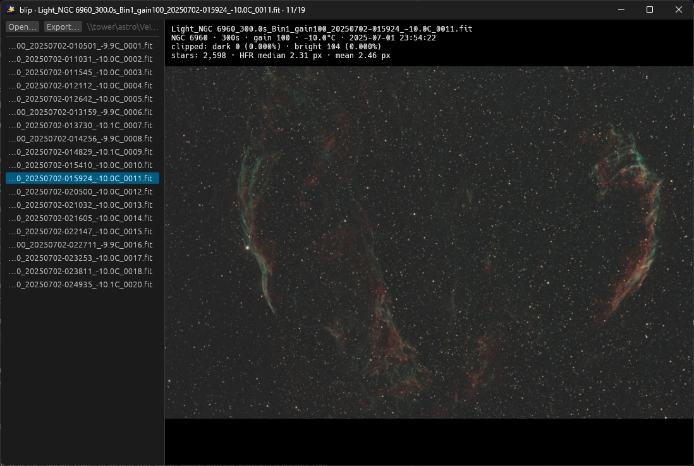

# blip

**B**atch **L**ightframe **I**nspection & **P**review: a minimal, fast FITS and XISF
blinker for astro images, hardware-accelerated on the GPU.



## Install

Download the Windows installer (or the portable `.zip`, which needs no setup), the macOS disk
image, or the Linux Flatpak (x86_64 or aarch64) or `.tar.gz` from the
[releases](../../releases). Install the Flatpak with
`flatpak install --user blip-<version>-linux-<arch>.flatpak`.

To build from source you need Rust 1.95 or newer (the MSVC toolchain on Windows).

```sh
cargo build --release
```

## Keys

| Key | Action |
| --- | --- |
| <kbd>↓</kbd>, <kbd>→</kbd>, <kbd>Space</kbd> or <kbd>J</kbd> | next image |
| <kbd>↑</kbd>, <kbd>←</kbd> or <kbd>K</kbd> | previous image |
| <kbd>PgDn</kbd> / <kbd>PgUp</kbd> | jump 10 images forward / back |
| <kbd>Home</kbd> / <kbd>End</kbd> | jump to the first / last image |
| <kbd>Delete</kbd> or <kbd>Backspace</kbd> | permanently delete the file, bypassing the recycle bin (asks first) |
| Mouse wheel / drag / double-click | zoom / pan / reset (zoom is kept while blinking) |
| <kbd>F</kbd> or <kbd>0</kbd> | reset zoom |
| <kbd>I</kbd> | toggle the info overlay (capture details, star size, clipping stats) |
| <kbd>D</kbd> | toggle the debug panel (timings, stretch values, cache, GPU) |
| <kbd>N</kbd> | toggle background neutralization (auto white balance) |
| <kbd>S</kbd> | toggle the measured star sizes (HFR) on the current image |
| <kbd>B</kbd> | toggle binned preview / full resolution |
| <kbd>A</kbd> | toggle auto stretch for the current image (off shows the data linearly) |
| <kbd>C</kbd> | toggle flashing clipped pixels on the current image (red = saturated, blue = black) |
| <kbd>F5</kbd> or <kbd>Ctrl</kbd>+<kbd>R</kbd> (<kbd>Cmd</kbd>+<kbd>R</kbd> on macOS) | rescan the folder |
| <kbd>O</kbd> or <kbd>Ctrl</kbd>+<kbd>O</kbd> (<kbd>Cmd</kbd>+<kbd>O</kbd> on macOS) | open a folder (or drag a folder or FITS / XISF file onto the window) |
| <kbd>?</kbd> or <kbd>F1</kbd> | show all shortcuts |
| <kbd>E</kbd> or <kbd>Ctrl</kbd>+<kbd>S</kbd> (<kbd>Cmd</kbd>+<kbd>S</kbd> on macOS) | export the stretched image (full resolution) as PNG or JPEG |

## License

[MIT](LICENSE). Release packages include the third-party licenses in
`THIRD_PARTY_LICENSES.txt`.
